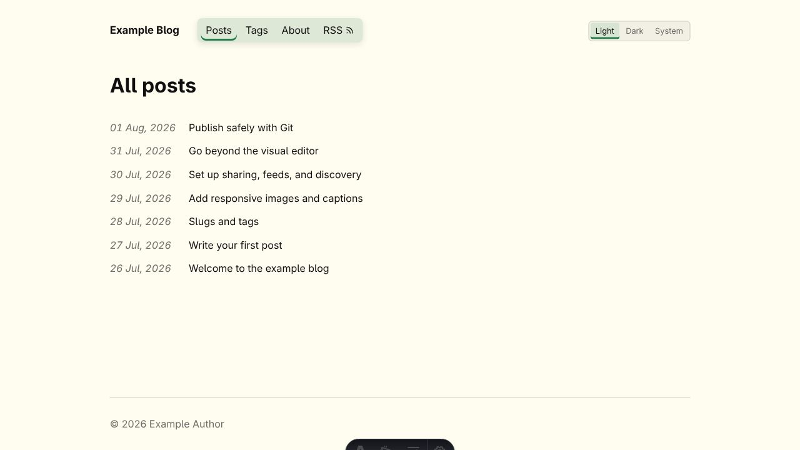
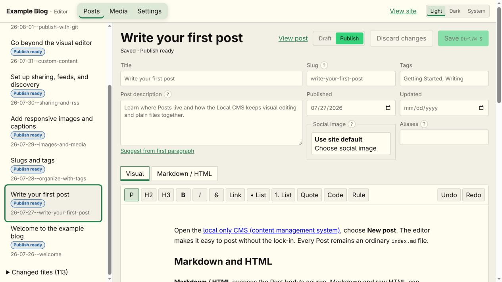

# SLAB - Static, Locally Authored Blog

A local Svelte CMS writes Markdown and configuration files; Astro builds them into an audited static HTML site published through Git.





Built for myself and for people comfortable with Git who want a better way to write than editing Markdown by hand.

- Simple, readable design using system fonts
- Accessible, responsive, light/dark/system UI
- Local visual CMS backed by ordinary Markdown and Git
- Static, audited production output

## Run

```sh
npm install
npm run dev
```

- Blog: <http://127.0.0.1:4321/>
- CMS: <http://127.0.0.1:4321/cms/>

## Deploy

- Create a **private**(if you want draft posts to remain private) GitHub repository and push this project to `main`.
- Create a Cloudflare Pages **Direct Upload** project.
- Create a Cloudflare API token with **Account → Cloudflare Pages → Edit**.
- Add `CLOUDFLARE_ACCOUNT_ID` and `CLOUDFLARE_API_TOKEN` under **GitHub repository → Settings → Secrets and variables → Actions → Secrets → New repository secret**.
- Add `CLOUDFLARE_PAGES_PROJECT` under **GitHub repository → Settings → Secrets and variables → Actions → Variables → New repository variable**; use the Pages project name as its value.
- Push `main`; GitHub Actions builds and deploys the audited `dist` directory.
- Optionally attach a custom domain in Cloudflare and set the same URL in CMS Settings.
